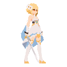

# 荧：133 像素轮廓修整

上轮 489 图元稿未获验收。相同的源图、裁切、脚底和显示尺寸，先看 Image Editor **直接导出的 133×133**，再放大定位瑕疵。不拿 4 倍缩小图当原尺寸，也不把原图或测试背景烧入模型。

- 借 [怪物大色面量产](../../../../../../docs/art/NATIVE_MONSTER_PRODUCTION.md) 已确认的两件事：以连续的大色面撑起剪影，按实际战斗大小审查边缘；不照搬怪物预算。不挪用背景的官方贴图，也不引入产品动作、音效、遮罩或纹理。
- 保住眼睛与脸中央，沿发饰、肩、披风、剑刃和鞋底逐段对齐。先在直接导出上校准相邻图元的覆盖，避免缝与单点闪出；再用 **9 个半透明原生长条**垫在相应颜色平面底下，替换 9 个几乎不影响画面的旧图元，最后处理发饰与脚边的突出点。源图原件留存，不重画姿势。
- 直接 133px：边缘区 RGB 平均差（对最新参考、固定深灰底）44.05→28.13，启发式高对比边缘凸点 7→5，单像素孔 1→0，内部孤立色点 36→29，锁定脸区零像素变化。4 倍诊断图的内部孤立色点指标 101→116，因此不宣称所有尺度都去除了噪点；斜剑刃仍有阶梯。
- **489 原生图元 + 9 批次容器 + 1 角色宿主 + 1 独立界面根 = 500 控件**。离线样片 GIL **143,601 B**。两次从调整到打包逐字节一致；从 GIL 回读全部 489 行并通过现有的 Lua 模拟，含原生颜色透明度、顺序、创建、释放和失败恢复。**不是实机验证、正式接入或用户视觉通过。**



## 复跑

沿用 [500 控件原稿](../face-polish-500-controls) 的项目工具和固定版本。从原稿的 `editable.json` 重放本次可审阅的原生位置、尺寸和边缘下垫层。重放不需要输入原图，审边和重新拟合要用原始同哈希 PNG。先用本目录 `replay.py`，再沿用上一轮的 `export-batches → prepare-base → pack → check-lifecycle`。

```sh
S=art/characters/battle-figure-experiments/2026-11-19/lumine
python "$S/edge-polish-133/replay.py" --editor "$EDITOR" \
  --baseline "$S/face-polish-500-controls/editable.json" --output "$OUT/native"
python "$S/edge-polish-133/verify-edge.py" "$BASE_ART" "$OUT/native" \
  "$SOURCE_PREVIEWS" "$OUT/metrics.json"
```

新角色复用的是顺序，不是荧的坐标：先画连续大面并明确要保护的脸和武器；按直接小图找误差最高的接缝、尖点；先对齐几何，只有不能覆盖的过渡才加同色原生半透明条。总数不增加，分别检查小图、放大诊断和设备。不要为了数值改掉实际造型。
