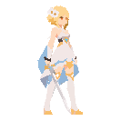

# 荧：133 像素眼部重做

[上一轮边缘稿](../edge-polish-133)保留，但它没有修眼睛。实际 133×133 渲染里，上一版近眼的深色碎片被压到同一行，形成过宽过黑的一条线；远眼过宽且断色，丢了原图的透视。以同一原图、同一尺寸的近远眼为目标，**删掉旧的 36 块眼部图元，换成 11 个连续的三角/椭圆**。近眼保留短眼线、浅色眼白边和下方琥珀色，远眼只留细窄的眼线和虹膜。没有重画脸、头发、衣服、姿势或剪影，也没有运行时贴图。

- 直接 133×133：改动 35 个眼部像素，眼部以外逐像素一致；Alpha 完全不变。对原图眼区 RGB MAE 17.25→9.32；4 倍用于诊断，眼区以外同样无像素变化。放大仍没有还原原图眼线的完整弧度。
- **464 原生图元 + 8 分组 + 1 角色宿主 + 1 界面根＝474 控件**，不计模板定义。离线夹具 GIL 136,102 B。双次打包回读一致，全部 464 原生图元通过既有 Lua 模拟生命周期和回读。未导入官方客户端，未接入 Release，待 Owner 视觉复核。



## 复现

使用上一轮仓库固定版本，从眼部未改的 `edge-polish-133/editable.json` 重放版本化几何参数。与原图比较时要用同 SHA 的用户原图；不把原图写成项目运行素材。

```sh
A=art/characters/battle-figure-experiments/2026-11-19/lumine
python "$A/eye-rebuild-133/replay.py" --editor "$EDITOR" \
  --baseline "$A/edge-polish-133/editable.json" --output "$OUT/eyes"
python "$A/export-batches.py" "$EDITOR" "$OUT/eyes" "$OUT/batches"
```

之后沿用 `prepare-base → pack → check-lifecycle`。源图哈希、可编辑图元、可复现变更与检查读数分别记录。
