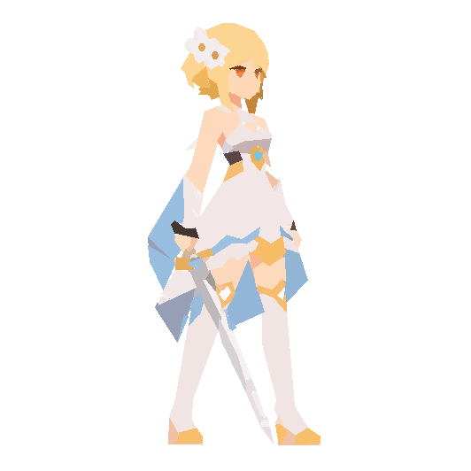

# 荧：脸部精修 / 500 控件原生样片

最新原图留在资料库，原件与实验均可按 SHA-256 找回。相对 [549 版](../latest-owner-ref-549)，重做两眼眼线、虹膜和颊面。先出 598 图元精修档，脸外与旧稿逐像素一致。500 控件档只剔除低损耗原生图元：头部锁定，领口、胸饰、剑刃和轮廓优先保留。同一 133×133 离线 Image Editor 视图，头部与 598 档逐像素一致，透明轮廓也完全一致；4 倍离线渲染有少量衣片色块与边缘差异。远眼放大仍不如原图细润。

- **489 原生图元（487 三角、2 椭圆）+ 9 批次容器 + 1 角色宿主 + 1 界面根 = 500 控件**，模板定义不算实例。无位图、遮罩、背景或运行时文字。
- 两次独立的清理、导出及离线打包逐字一致。样片 GIL **143,794 B**，比同一干净夹具多 **118,001 B**；绑定 Lua **108,902 B**。从 GIL 回读验证 489 个图元的几何、顺序、颜色、生命周期及失败恢复。不是正式存档；未做官方导入、实机帧率或发布验收。
- 每个阶段保持原生可编辑，输入只要求同一原图与 549 基线；无需安装新工具。其他体型未验证，本样片不能视作量产方案已通过。
 


## 复用

沿用[现有固定版本和依赖](../README.md)：先按 [549 导出说明](../latest-owner-ref-549/README.md) 写出基线到 `$BASE_ART`，其中包括两种尺寸的原图预览、可编辑 JSON、Lua 解码。以下调用不改源图或基线，输出目录须新建：

```sh
A=art/characters/battle-figure-experiments/2026-11-19/lumine
S="$A/face-polish-500-controls"
python "$S/face-patch.py" --repo "$PWD" --editor "$EDITOR" \
  --baseline "$BASE_ART/editable.json" --source "$SOURCE_PNG" --output "$OUT/face"
python "$S/budget-native.py" --editor "$EDITOR" --baseline "$OUT/face" \
  --comparison "$BASE_ART" --target 489 --output "$OUT/budget"
python "$A/export-batches.py" "$EDITOR" "$OUT/budget" "$OUT/batches"
```

沿用上一阶段的 `prepare-base → pack → check-lifecycle` 夹具链路。文件中的紧凑 editable JSON 与原始导出语义一致。换下一个角色时沿用预算与预检，不复制荧的坐标：按各自原图标注关键特征与细化区域，先确定人物像、再削减非重点面；以 1× 和 4× 同尺寸截图评审。
