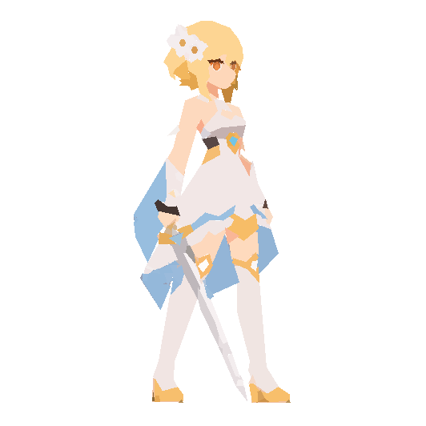

# 荧 · 最新直传平涂参考 / 549 图元实验

**仅离线、待视觉验收，非正式接入。** 前面的拟合（包括 430 图元版）均未获通过。用户新上传的平涂图是本轮唯一画面基准。原始 PNG 完整留在用户资料库；这里仅保存拟合结果和复跑所需的 SHA/参数，不重复公开上传原件。

- 原始 PNG 1448×1086，1,276,140 B；SHA-256 `bc9118f85b57b2ca70ec027c43a520c3bb2d0f403e4f0f6e167d4297c63a1ff5`。裁切 LTRB (0,280,234,834)，RGB max >32 的最大连通块排除胡桃邻角。图像 133×133，原样比例、持剑、脚线。
- 这张图用大面积、内色差较小的象牙白/蓝/金色块，采用 **直接提取源图色块** 而不是重设计衣片。复用项目的轮廓裁切、约束三角剖分、单轴摆放、Image Editor 导出及 Lua 处理。琥珀眼与两朵花芯复核少量原生椭圆／三角叠层；原图像素没有打进运行时。
- 549 个图元：542 个原生三角和 7 个椭圆。10 组加 1 角色宿主，共 **560 角色控件**；测试界面根另计为 561，模板定义不算实例。无栅格纹理、蒙版、文字或背景。与 719 图元试样相比，独立视觉核查看不出额外 170 个图元在 133px 带来的相称收益。放大仍能看见花瓣、眼线、剑护手和腿缘的轻微锯齿；待用户判断实际观感。
- 549 样片 GIL **157,761 B**，减同一干净夹具 25,793 B 后为 **+131,968 B**。绑定 Lua **122,048 B**。719 仅离线对照：194,026 B，绑定 Lua 156,833 B。两案均双次重放/打包逐字一致，精确 GIL 回读时验证了全部图元的姿态、颜色、次序、创建/释放与注入失败恢复。**无官方导入、运行截图、帧率、实机容量或正式存档验证。**



## 复跑

沿用[父目录版本钉扎与依赖](../README.md)。须使用用户授权获得的同一 SHA 原图。新脚本只是隔离样本的直接色块适配及部位权重筛选；无项目接入变更。

```sh
A=art/characters/battle-figure-experiments/2026-11-19/lumine
S="$A/latest-owner-ref-549"
O=/absolute/new/lumine-latest-549
mkdir "$O"
python "$S/assembly-stabilized.py" --repo "$PWD" --editor "$EDITOR" \
  --medium "$SOURCE_PNG" --profile balanced --budget 530 --output "$O/art"
python "$A/export-batches.py" "$EDITOR" "$O/art" "$O/batches"
export LOCALAPPDATA="$O/appdata" MILIASTRA_SAVE_ROOTS='[]' MILIASTRA_ALLOW_LIVE_WRITE=0
BASE=$(node "$A/prepare-base.mjs" "$MCP_TOOL" "$O/base")
node "$A/pack.mjs" "$MCP_TOOL" "$BASE" "$O/batches" "$O/save"
node "$A/check-lifecycle.mjs" "$MCP_TOOL" "$PWD/node_modules/fengari" \
  "$PWD/tests/fixtures/image-editor-103025-checker.cjs" \
  "$O/art/literal-drawing.json" "$O/save/gil-proof.json"
```

719 对照参数 `--profile fidelity --budget 700`。实际图元数含 19 个局部锚点。入库 `editable.json` 为紧凑 JSON 序列化，receipt 中为导出原字节哈希；Lua 可由绑定分批流程复现。
