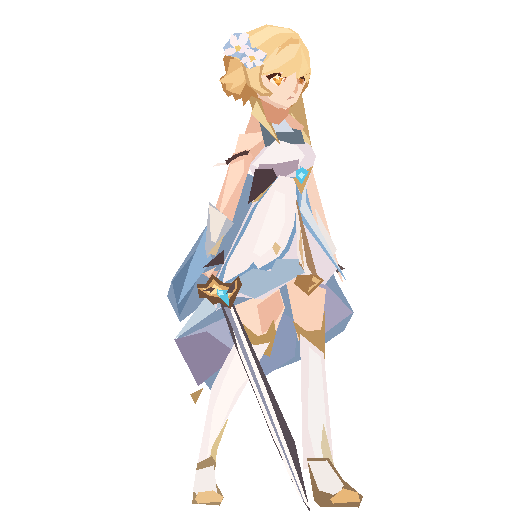

# 荧 · 新参考重拟合（499a8366）

342 图元版已被 Owner 拒绝，旧版只留追溯。**这是新的待审离线样片，不是量产批准。**
以 [499a8366 的三档参考](https://github.com/FurinyaWorks/Slay-the-Heavens/tree/499a8366d81924dc675797f46c8cd5564d0e12d2/art/characters/battle-figure-reference/2026-11-19) 为风格来源，仍以原姿态稿为人物比例、持剑、脚线的几何基准。以中档重画脸、刘海、花饰和金蓝护手，披布与腿采用低档的大面处理。无背景、纹理或蒙版。未做其他角色。



| 对象 | 实测 |
| --- | --- |
| 图元 | 447 个原生三角图片（100003）；脸发 186、衣服 100、腿靴 63、剑 50、披带 26、手臂 22 |
| 控件 | 八组 60/60/60/60/60/60/60/27；含角色宿主为 456，试验界面根另计为 457；0 蒙版；1 个模板定义不计实例 |
| 试样 | 整个独立离线 GIL 132,860 B，较同测试底样增加 107,067 B；其中实际绑定 Lua 合计 98,699 B |
| 校验 | 447 原生行已从 GIL 回读，包含三轴旋转、图层顺序、颜色、创建／释放、注入失败的清理与恢复；两次打包逐字一致 |

结果在已有 Image Editor 和 Lua 导出链生成。自动色块转写试过，但大于千图元且碎脸，未选。精描版取 level 6：对花瓣、上睫、肩带、剑刃和双靴保留更细的轮廓容差；416 早稿的裙中金块过宽、裙缘和小腿过直，因此最终保留 31 个额外图元细化轮廓与留白。鞋和花仍是几何简化，不是像素复制。

## 重跑

在原实验分支仓库根执行。STYLE 指定上面固定提交的参考目录，含 `style-medium-detail.png` 和 `style-low-detail.png`；原姿态从当前仓库原 #744 文件读取。依赖版本和 Image Editor、MCP tool 位置沿用 [上一轮的工具说明](../README.md)，输出目录必须全新。

```sh
A=art/characters/battle-figure-experiments/2026-11-19/lumine
O=/absolute/new/lumine-v2
mkdir "$O"
python "$A/rework-499a8366/replay.py" --repo "$PWD" --editor "$EDITOR" --styles "$STYLE" --level 6 --output "$O/art"
python "$A/export-batches.py" "$EDITOR" "$O/art" "$O/batches"
export LOCALAPPDATA="$O/appdata" MILIASTRA_SAVE_ROOTS='[]' MILIASTRA_ALLOW_LIVE_WRITE=0
BASE=$(node "$A/prepare-base.mjs" "$MCP_TOOL" "$O/base")
node "$A/pack.mjs" "$MCP_TOOL" "$BASE" "$O/batches" "$O/save"
node "$A/check-lifecycle.mjs" "$MCP_TOOL" "$PWD/node_modules/fengari" \
  "$PWD/tests/fixtures/image-editor-103025-checker.cjs" \
  "$O/art/literal-drawing.json" "$O/save/gil-proof.json"
```

`editable.json` 是规范化导出的紧凑版；记录中的文件哈希来自通常排版的原始导出。原生运行、官方容量、PC 和手机帧率均尚未验证。试样和画质评审不改变项目正式存档、`develop` 或 Release。
