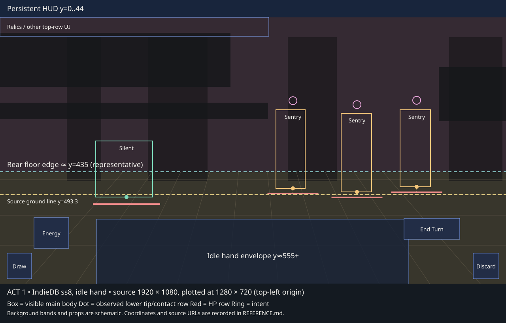
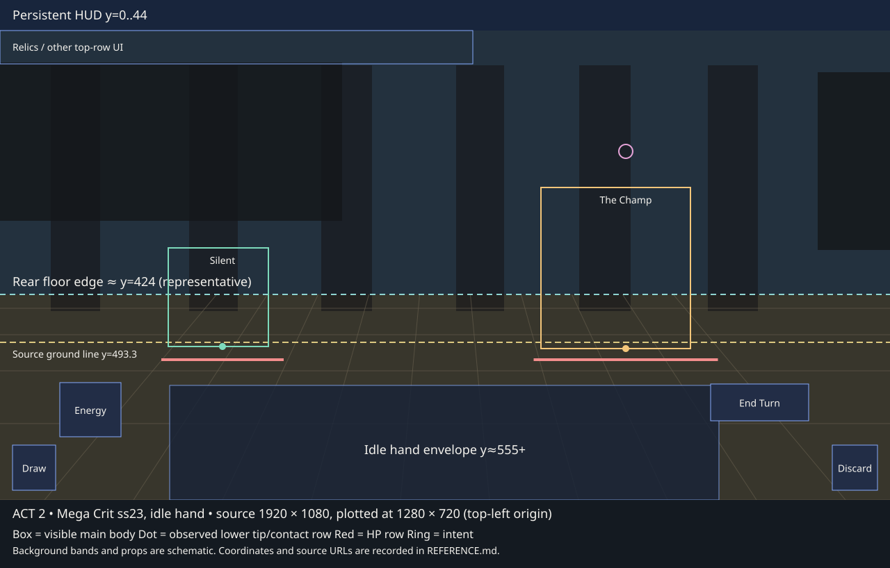

# v2.2.0 两幕战斗的原版参考与实施参数

| 版本 | 设计修订 | 状态 | 关联 |
| --- | --- | --- | --- |
| v2.2.0 | `sts1-battle-scenes-20261125` | 当前研究稿。测量基于原版实机截图，项目正式稿与 Simulator 验收待评审 | TASK-115.7.1。供 TASK-115.6、TASK-115.7.2、TASK-115.7.3 使用 |

现行工作基线为 `27e2f8304bcbaedffa0efbc02d739bd4aeab38b6`。旧 M4 场景原生 3D 方案与旧战斗 UI 浏览器稿保留为相应历史版本背景，v2.2.0 两幕构图改用本文参照。上一版项目战斗截图只作改造前基线。项目角色、敌人、UI 美术及世界观延续本项目的资产与生产约束。下列原版图片由来源网站提供，用于读图和评审。仓库仅存自绘的坐标标注图。[历史 M4 方案](../../../BACKGROUND_PROPOSAL.md) · [历史正式战斗 UI 对照](../../../FORMAL_BATTLE_UI.md) · [项目上一版离线投影](../../../../evidence/v2-ui-20261119/p1/runtime-battle.png)

## 第一幕 Exordium

| 原版战斗截图 | 对应无 UI 环境画面 |
| --- | --- |
|  |  |

两图可在左侧折线墙体、破口中的冷紫远景、石板地及底部断裂前景上相互辨认。墙洞和火把随房型与截图版本变化。颜色以焦褐暖墙与冷紫空洞区分深度，靠前的石面比墙体略亮，最前缘再次变暗。*Mega Crit* 九月截图亮点集中于中间两束火光，横向敌人信息仍依靠偏暗的墙面和单位局部高值分开。底部暗碎石压住画面边缘并给牌堆与手牌提供底色。Bruce 的作品集首张《Slay the Spire》图是宣传画，第一幕空景在此引用第三方 Exordium 图，原始图层名称按固定源码标注。[Mega Crit 九月同遭遇](https://www.megacrit.com/images/ss8.jpg) · [第一幕空景出处](https://www.hermitgamer.com/how-many-acts-in-slay-the-spire/) · [Bruce Brenneise 作品集](https://www.brucebrenneise.com/game-concepts) · [原版 TheBottomScene](https://github.com/aeubanks/sts/blob/319009d5df0a82d9fb0f23cc22322286c6a87ec0/scenes/TheBottomScene.java#L58-L70)

补充样本的史莱姆首领躯体宽约 246、高约 178，触地在 y≈497。三哨卫单体最宽约 77、高约 199，横向间距 151–162，浮体底点各不相同，在地面与血条之间留下可见间隙。九月截图的悬停卡会短时覆盖最左哨卫下沿。验证常态布局时使用四月无悬停画面，验证选择态时保留九月悬停例。Steam 的第一幕 Defect 触发落雷图提供前景瞬时覆盖与反馈叠层参照。[史莱姆首领实机](https://media.indiedb.com/images/presskit/1/1/483/general/ss13.jpg) · [悬停手牌实机](https://www.megacrit.com/images/ss8.jpg) · [落雷实机](https://shared.akamai.steamstatic.com/store_item_assets/steam/apps/646570/ss_01aa3e7759e457bfbf2422f31c325d7b3ba8a6eb.1920x1080.jpg)

## 第二幕 The City

| 原版战斗截图 | 对应背景美术师原画 |
| --- | --- |
|  |  |

原画和实机共享暗色天花、棕柱、蓝青远城、茶橘小窗与带透视的宽石台。原画右侧王座属于可单独配置的道具，The Champ 截图是开放柱列变体。柱与地面形成深度基准，前景的墙脚和石堆主要进入边缘与底部。亮窗形成小面积点光，主地面保持低饱和度。前景低值可以框住对比强的盔甲、浅色边缘和 UI。Steam Snecko 战斗样本展示了房间右半存在暗墙与铁链的真实布局差异，以及一次短时满屏施法特效。[官方媒体图](https://www.megacrit.com/images/ss23.jpg) · [Bruce Brenneise 作品集](https://www.brucebrenneise.com/game-concepts) · [Snecko 实机](https://shared.akamai.steamstatic.com/store_item_assets/steam/apps/646570/ss_c171816f7ecd35b5b46d2fa27532f4c5b8ca3cc5.1920x1080.jpg) · [原版 TheCityScene 房型逻辑](https://github.com/aeubanks/sts/blob/319009d5df0a82d9fb0f23cc22322286c6a87ec0/scenes/TheCityScene.java#L185-L198)

The Champ 的可见外轮廓含盾剑较宽，站姿底点与角色处于同一地面带。Snecko 最宽约 194、高约 177，仍沿同一地面带。与瘦小玩家和一次只出现一只的大型首领相比，构图的主要变化是单位包围盒、血条宽度与意图位置。两张 Champ 截图中地面和柱位基本相同，远城层与火光分布不同。[The Champ 替代媒体图](https://media.indiedb.com/images/presskit/1/1/483/general/ss23.jpg)

## 坐标记录

以图像左上为原点。1920×1080 媒体截图坐标乘 2/3 得到 1280×720 标注。轮廓、地面接缝和阴影为截图目测，单点误差约 ±6。背景原画尺寸不同，主要用于确认深度层次，不参与像素坐标或拉伸比推导。武器水平伸展另外检查，以避免用武器尖端决定立绘中心。

| 样本 | 可见身体/姿态锚点 x、下沿 y | 包围盒宽×高 | 血条中心 y、意图中心 y |
| --- | --- | --- | --- |
| 第一幕 Mega Crit ss8 铁甲战士 | 约 336、497，逻辑 x=320。两脚约 x=294、384 | 人体 109×156，含武器约 205×156 | 512。玩家无敌方意图 |
| 第一幕 IndyDB ss8 静默猎手 | 约 320、499 | 144×142 | 517。玩家无敌方意图 |
| 第一幕 IndyDB ss8 三哨卫 | 741/903/1054，最低尖端 477/486/473 | 74–77×195–199 | 490/500/487。约 255/265/254 |
| 第一幕 IndyDB ss13 史莱姆首领 | 约 960、497 | 246×178 | 523。约 260 |
| 第二幕 Mega Crit ss23 静默猎手 | 约 320、499 | 144×142 | 518。玩家无敌方意图 |
| 第二幕 Mega Crit ss23 The Champ | 约 900、502。两脚约 x=888、946 | 含盾剑 215×232 | 518。约 218 |
| 第二幕 Steam Snecko | 约 940、500 | 194×177 | 518。特效中约 290 |

- 第一幕可读的后墙/地面交线约 y=424–450，第二幕开放柱列后沿约 y=420–430，柱脚约 y=437–448。共同逻辑地线 y=493.3，两幕可见贴地身体落点 y≈490–505。石面持续到前缘，透视通过近处石板更大、缝距更宽表达。后墙与石地交线对应地面的远端，角色位于交线前方。远景透视存在横向多组方向，表中后沿仅记录可见的墙地交线。
- 不动作时，截图顶部固定条 y=0–44，遗物下沿约 y=90，血条/状态水平带约 y=487–551，牌扇上边约 y=550–565。能量中心约 x=131、y=591，结束回合中心约 x=1090、y=580，抽/弃牌堆约 x=50/1230、y=671。卡牌悬停、出牌与拖拽期间可进入高位，作为瞬态验证，保留意图、触点及反馈。
- 同一空间中足底附近有很短的暗缘，悬浮哨卫保留有意间隙。从截图无法区分每处暗缘来自底图、角色绘制还是阴影贴图。固定源码的通用玩家和怪物绘制段也没有证明每个资产都加一层独立阴影。项目可对比保留地纹、局部接触暗部这两种渲染，同一角色、站姿、光照和背景下决定是否需要增加极薄接触层。

## 明暗与色彩采样

下表使用现场截图的矩形斑块，对每个 RGB 通道取中位数。Y 是 sRGB 编码值的近似亮度 `0.2126R+0.7152G+0.0722B`，范围 0–255，作用是记录色彩层次与局部对比。设备验收继续沿用仓库 UI、容量、图元及性能标准。

| 截图 | 采样区域、源图坐标矩形 x₀,y₀–x₁,y₁ | RGB 中位、Y 中位 |
| --- | --- | --- |
| 第一幕 Mega Crit ss8 | 暖中景墙 566,410–635,480。冷洞 945,447–1012,517 | `#3a1503` 28。`#371e34` 37 |
| 第一幕 Mega Crit ss8 | 脚线附近石地 647,682–745,745。暗前缘 1731,953–1773,1018。火把 773,272–814,319 | `#53472c` 72。`#270f06` 20。`#c36d28` 122 |
| 第一幕 Mega Crit ss8 | 铁甲战士胸口 488,596–514,626。哨卫 1334,482–1365,533 | `#2c2217` 35。`#c1b791` 182 |
| 第二幕 Mega Crit ss23 | 蓝远景 1112,210–1175,278。暖柱 707,202–761,294。亮窗 1430,195–1459,235 | `#1a2f40` 44。`#321b0c` 31。`#503c3b` 64 |
| 第二幕 Mega Crit ss23 | 脚线附近石地 644,686–748,757。暗前缘 1730,927–1780,1001 | `#25271e` 38。`#14130d` 19 |
| 第二幕 Mega Crit ss23 | 静默猎手披风 483,650–527,687。冠军盔甲 1321,504–1361,545 | `#547e66` 115。`#5c97a5` 140 |

铁甲战士胸口与洞背景相近，局部盔甲边缘、肤色、腿部暖红和运动共同提供辨识度。实际验收应同时看明暗与色边界，尤其在暗色敌人和幅度较大的选牌、出牌特效中。

## 源码交叉核对

研究以项目既有 STS1 来源 `319009d5df0a82d9fb0f23cc22322286c6a87ec0` 为准。源快照与媒体截图版本不同，以下常量用于说明原版规则，截图坐标以目测为准。

| 主题 | 源码可确认的做法 |
| --- | --- |
| 地面与比例 | 原版下方原点的 `floorY=340*yScale` 在 1280×720 等比画布上对应左上原点 y=493.33。角色 x 为画布宽度 25%，普通敌人 x 为 75% 加遭遇偏移。演员立绘使用同一 `scale`，宽屏时源码另算横向位置比例与等比例尺寸。 [地线](https://github.com/aeubanks/sts/blob/319009d5df0a82d9fb0f23cc22322286c6a87ec0/dungeons/AbstractDungeon.java#L2727-L2733) · [玩家](https://github.com/aeubanks/sts/blob/319009d5df0a82d9fb0f23cc22322286c6a87ec0/characters/AbstractPlayer.java#L184-L190) · [怪物](https://github.com/aeubanks/sts/blob/319009d5df0a82d9fb0f23cc22322286c6a87ec0/monsters/AbstractMonster.java#L131-L145) · [宽屏比例](https://github.com/aeubanks/sts/blob/319009d5df0a82d9fb0f23cc22322286c6a87ec0/core/Settings.java#L238-L274) |
| 敌群 | 三哨卫的原版中心位近似 `(740,477)、(903,487)、(1053,473)`。第二幕三奴隶主源位置约 `(703,503)、(871,493)、(1043,513)`。寄生兽与真菌组合约 `(787,483)、(1040,493)`。冠军 `x=900`、基础地线 `y=493.3`。这些是按源偏移换算的绘制枢轴，存在与可见下沿不同的情况。 [遭遇构造](https://github.com/aeubanks/sts/blob/319009d5df0a82d9fb0f23cc22322286c6a87ec0/helpers/MonsterHelper.java#L431-L520) · [冠军](https://github.com/aeubanks/sts/blob/319009d5df0a82d9fb0f23cc22322286c6a87ec0/monsters/city/Champ.java#L87-L94) |
| 背景 | 第一幕 `bottomScene/scene.atlas` 中有远底、雾、中景、墙、顶、火把及前景碎石的合成顺序。第二幕 `cityScene/scene.atlas` 单独合成远景、发光点、地板、墙、顶、柱组和房间前景，冠军变体不带收藏家的王座。 [第一幕绘制](https://github.com/aeubanks/sts/blob/319009d5df0a82d9fb0f23cc22322286c6a87ec0/scenes/TheBottomScene.java#L165-L193) · [第二幕图册](https://github.com/aeubanks/sts/blob/319009d5df0a82d9fb0f23cc22322286c6a87ec0/scenes/TheCityScene.java#L68-L93) · [第二幕绘制](https://github.com/aeubanks/sts/blob/319009d5df0a82d9fb0f23cc22322286c6a87ec0/scenes/TheCityScene.java#L212-L298) |
| 渲染顺序 | 背景和后置效果 → 房间内角色、敌人、单位状态和卡牌 → 边缘前景 → 前置效果 → 全局覆盖、黑幕和叠加页。怪物在自身绘制中先画立绘，再画意图和健康信息。移植中可以将场景前缘放在 HUD 下层。这保留参考图中前缘遮挡很少的可读结果。 [场景流程](https://github.com/aeubanks/sts/blob/319009d5df0a82d9fb0f23cc22322286c6a87ec0/dungeons/AbstractDungeon.java#L2133-L2170) · [房间流程](https://github.com/aeubanks/sts/blob/319009d5df0a82d9fb0f23cc22322286c6a87ec0/rooms/AbstractRoom.java#L462-L483) · [敌人流程](https://github.com/aeubanks/sts/blob/319009d5df0a82d9fb0f23cc22322286c6a87ec0/monsters/AbstractMonster.java#L705-L748) |

## 本项目首轮实施参数

这些参数用于联合设计与真实 Simulator 对照，实际宿主视口、安全区、可用输入坐标及旧导航必须先经 TASK-115.6 核实。坐标使用同一 1280×720 等比舞台，转入中心原点、向上为正时采用 `x'=x−640`、`y'=360−y`。

| 实施点 | 首轮参数与判定 |
| --- | --- |
| 第一幕场景 | 保持墙体和石台的舞台型剖面。后沿起始 y=430–445，主体使用 y=490–505 地面带。活动洞口、灯光和粗石可用项目岩系遗迹身份。把固定暖亮点放在主体头部/意图热区以外。地面开始处用小形状，向 y=650–700 扩大纹理。底部暗前缘优先从 y=575 往下并靠边，只作画面归边。 |
| 第二幕场景 | 保留开放栏柱与远城层级。后沿 y=420–432，柱脚 y=435–450，地面继续到画幅下沿。用项目第二幕建筑与灯具保留身份，浅青远景与少量橙灯形成分层。对头部和意图重叠位置选用低细节柱面或远景。大型装饰放在侧边或指定房型，固定画幅的角色区允许男/女主体和首领有相同地线。 |
| 单位接地 | 默认地线 y=493。动图锚点由批准资产上左/右接地点或底部明确登记。对普通地面单位以 alpha 紧边取脚而非纹理外框，保持 y=490–505。大型单位从脚线向上扩张，裁切手武器、尾部和发光单独验。浮空资产沿自身设计保持 y=473–487 一带的可见下沿，目标框仍随姿态。 |
| 布局安全 | 以实际主题配置为基础，参考 16:9 角色 x≈320、单敌枢轴 x≈900–960、多敌右侧 x≈700–1060。红条/格挡/状态始终走伴随单位坐标。相邻单位效果范围有重叠时，意图、血条/状态和触控矩形须逐个可达。混合敌群按躯体尺度与遭遇选横向间距和最少的纵向交错，优先共用源位置能力。四至五敌仍用项目正式合法遭遇测量。 |
| 接触暗缘 | 正式背景先运行原角色测试自然接地。仍出现漂浮感时，以单个可复用图元试验脚线处低对比接触层，不透明度 12–20%，纵向 4–8、横向为接地点跨度的 100–115%，随演员姿态和底色比较。无增益或破坏形态就舍弃。浮空和可见轮廓外有意留空需要独立对照。 |
| 宽屏 | 同一高度下参考画布宽 1280/1560/1600/1680，对应两侧各增加 0/140/160/200。每幕在主体尺度不变的情况下补画边缘延伸，保持后沿、石面与透视跨边界连续。战斗安全区依据宿主读回确定，场景晚些延伸区容纳背景边缘和外侧交互。角色、卡牌、图标沿各自原比例缩放，悬停/拖拽和命中共享实际布局的坐标。 |
| 当前 v3 生产入口 | `build-ui.mjs` 的 `officialAssets` 分支调用 `applyOfficialAssets`，经 `applyV25BattleScene` 将单个静态 `v25BattleScene` 置于战斗舞台首层并移除该层的 `lowpolyScene`。两幕当前共用该场景。 [构建分支](../../../../../scripts/build-ui.mjs#L198) · [原生生产布局](../../../../../scripts/official-assets-layout.mjs#L272) · [战斗场景](../../../../../scripts/v25-battle-scene.mjs#L149) |
| 旧配置入口 | 其他配置启用 `menuBackground` 时，`attachLowpolyScenes` 可将 `lowpolyScene` 挂到页面，运行时读取 `Asset.lowpolyLand`。v3 正式美术配置的 `menuBackground` 为 `false`。 [旧场景挂接](../../../../../scripts/official-portraits.mjs#L91) · [运行时](../../../../../src/lua/abyss_traveler_portraits.lua#L455) · [正式美术配置](../../../../../scripts/official-assets-profile.mjs#L3) |
| 两幕接入待实现 | 从正式 `v25BattleScene` 入口接入两幕资源，由当前章节和房间身份确定场景，切换与清理复用现有战斗页面生命周期。复验准备过渡、地图往返、同图复用和动效设置。敌人站位、反馈和命中使用统一的布局坐标。 [敌人布局与命中](../../../../../src/lua/abyss_battle_enemy_view.lua) |

## 本研究的验收位置

本稿提供原版画面、对应背景和测量。正式联合验收由 TASK-115.6、TASK-115.7.2、TASK-115.7.3 对同一候选使用 Simulator 渲染。两幕在 16:9、19.5:9、20:9、21:9 重跑，至少覆盖第一幕接地小敌、三浮体和宽首领，第二幕普通敌、混合多敌及高首领，补充静置、手牌抬起、拖选、密集特效和回合切换。逐屏绑定同一角色、种子、视口和构建身份的修改前后图。核对两侧全覆盖、像素比例、脚线、状态可读、交互矩形、每幕资源/帧时及透明资产四背景检测。基准、修改后画面和真实性能证据一起写入发布验收记录。

### 读取身份

2026-11-25 读取的来源。以下指纹用于区分同名媒体文件，图像仍由外部站点提供。

| 原件 | 像素 | SHA-256 |
| --- | --- | --- |
| [Mega Crit ss8](https://www.megacrit.com/images/ss8.jpg) | 1920×1080 | `ddeac12e57e3410b12027e46a1d2be57cb694b636e393b562e1d1b33d10ab27d` |
| [IndieDB ss8](https://media.indiedb.com/images/presskit/1/1/483/general/ss8.jpg) | 1920×1080 | `2a0d41cf397b2bd76c9f5da0b8048e87ff2c16338ef1f760e24ebb403c0dd8aa` |
| [IndieDB ss13](https://media.indiedb.com/images/presskit/1/1/483/general/ss13.jpg) | 1920×1080 | `1005bcb703605239a7a2841d312754fe4429b4b5092763d3cb4564200a3c5319` |
| [Exordium 空景](https://www.hermitgamer.com/storage/attachments/images/the-exordium.webp) | 1600×947 | `150ccb7c4e7c8bfbe82ec839b9c72fccfe9cf67d0bcaeab41a345518c1325160` |
| [Mega Crit ss23](https://www.megacrit.com/images/ss23.jpg) | 1920×1080 | `6106019cba45efa85eab60c845562e21e872378e2104a724c610d6b15d2b0947` |
| [IndieDB ss23](https://media.indiedb.com/images/presskit/1/1/483/general/ss23.jpg) | 1920×1080 | `76abc93499202e5a29f30dae78f7a648e39e7bcdaaa431ef12bdf28a6a625d78` |
| [Steam Snecko](https://shared.akamai.steamstatic.com/store_item_assets/steam/apps/646570/ss_c171816f7ecd35b5b46d2fa27532f4c5b8ca3cc5.1920x1080.jpg) | 1920×1080 | `82c30d3444cd2a30d9c252005f39b81f3d99507efa6f75bcdd767d20dec37c90` |
| [Steam Defect 落雷](https://shared.akamai.steamstatic.com/store_item_assets/steam/apps/646570/ss_01aa3e7759e457bfbf2422f31c325d7b3ba8a6eb.1920x1080.jpg) | 1920×1080 | `c17f51c280502584fd54e78a78c8b8c8e6567192a38b61e3a9227572c88a1b5a` |
| [Bruce Brenneise 第二幕原画](https://images.squarespace-cdn.com/content/v1/5b76af6eb10598ab8a9f2588/1535205202521-YJVU8OK3QV41F5246Q33/STSLev2-BruceBrenneise) | 1690×1000 | `1026e68ed833b81be207e970fbec609cec8c26014dfe24c4f5f1c941c06bce64` |
