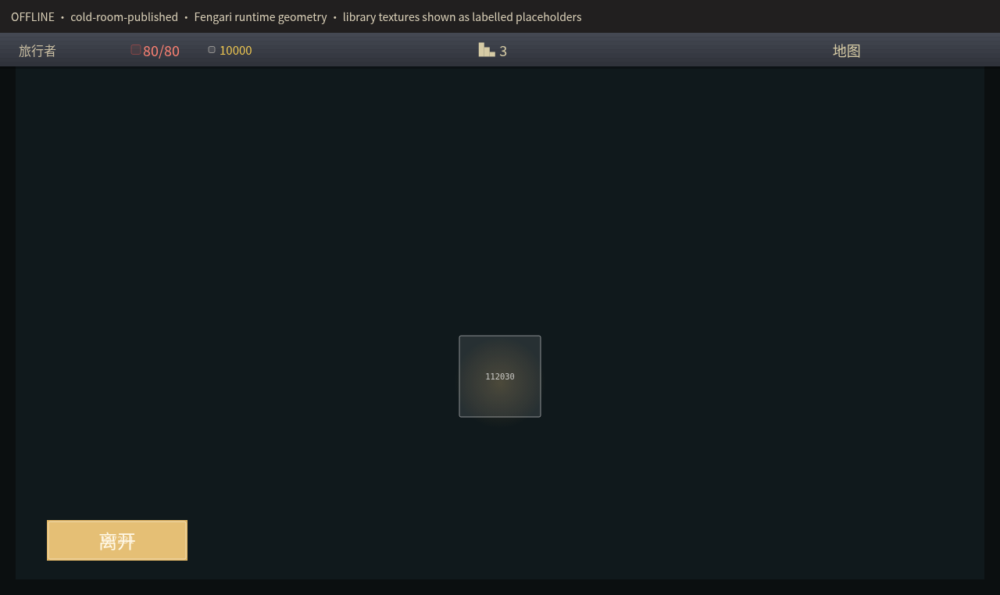
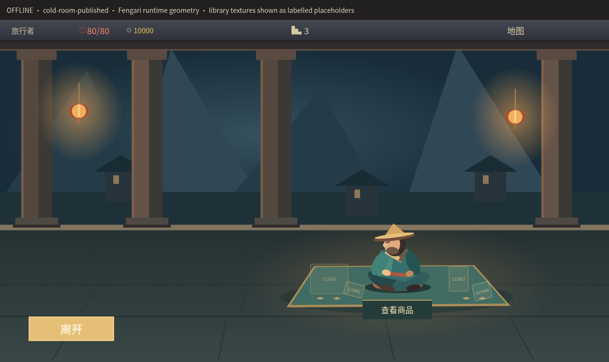
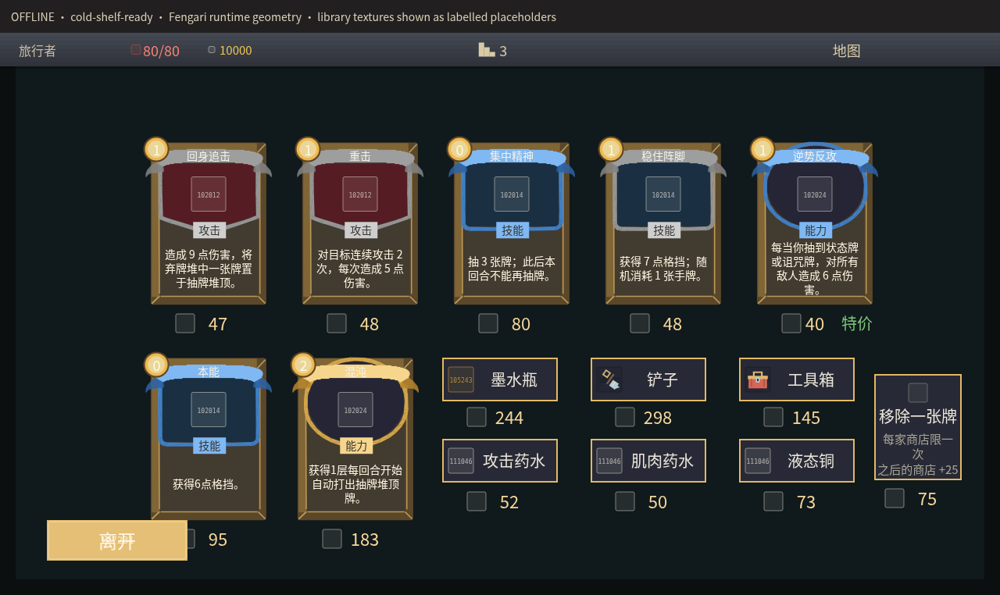
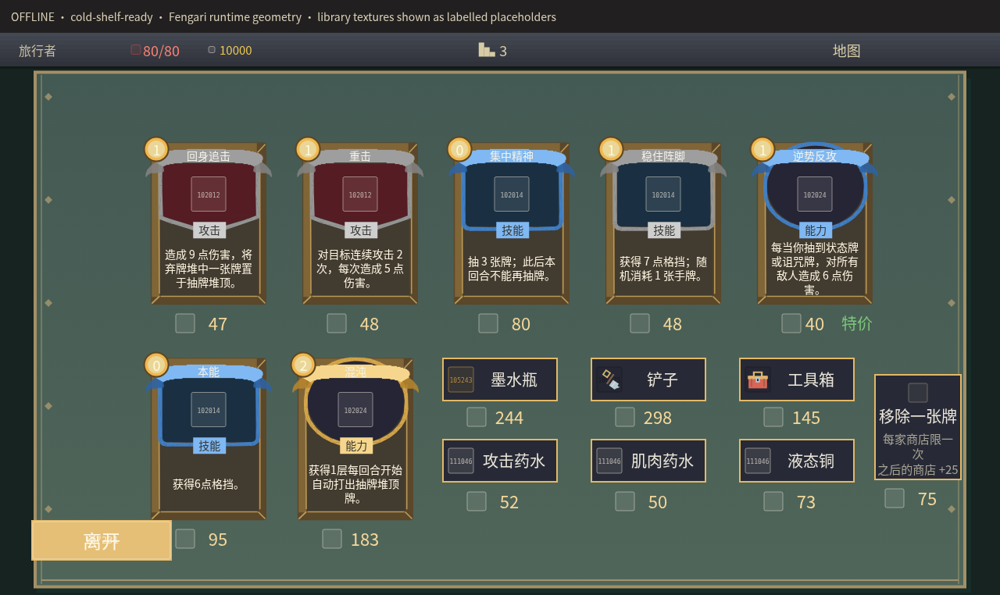

# 实机复验与离线复现

离线夹具走真实 GameUI 的地图节点选择、商人点击、购牌、确认离开和再次进店。它使用种子 1、固定金币、直接沿连通路线跳过其余房间，复用同一个 UI 控制器来测试第二次进店。原神编辑器、GPU 和真机均不参与这一步。

需要 Node 24、仓库锁定的 npm 依赖和 Git LFS。截图还需要 Python Playwright 与 Chromium，项目不需要浏览器账号、服务或访问令牌。先在两份干净工作树安装依赖并取回 LFS 文件。

```sh
npm ci
git lfs pull --include='art/characters/traveler-geo/portraits/avatar96/preview-native-1x.png,art/characters/traveler-geo/portraits/battle133/preview-native-1x.png' --exclude=''
```

在复现脚本所在目录执行以下命令。把路径替换成各自的绝对路径。两边应使用相同机器和参数，且顺序运行，避免互相影响计时。

```sh
SHOP_REFINED_RELEASE=1 node run.mjs /path/to/release-4ac434d /tmp/shop-828-before 9
SHOP_REFINED_RELEASE=1 node run.mjs /path/to/fix /tmp/shop-828-after 9
node paint.mjs /tmp/shop-828-before /tmp/shop-828-after
python screenshot.py /tmp/shop-828-before /tmp/shop-828-after
```

`report.json` 记录墙钟耗时、P50、P95、模拟时钟和控件调用次数。地图点击耗时包含地图与上下文切换，`node.render` 另计界面构建，`node.activationToVisibility` 记录规则进入完成到告诉模拟控件显示根节点的时间。入口首帧的画面树另在 `cold-room-published.png`。`cold-shelf-start.png`、`cold-shelf-first-update.png`、`cold-shelf-mid.png` 和 `cold-shelf-ready.png` 记录商人点击后的画面。浏览器 PNG 使用生成的官方布局与 Lua 状态，基本形状按坐标绘制，未知图库贴图以 ID 方框显示。在准备与滑动阶段分开计时。设置 `SHOP_DWELL_TICKS=10` 可复现停留 333ms 后点击。计时是带调用记录的 Linux Fengari 执行时间，无法推断客户端 FPS、资源上传、手机帧时间或真实触屏延迟。

## 画面对照

| 阶段 | 原版参考 | Release 修复前 | 修复后离线投影 |
| --- | --- | --- | --- |
| 商人房间 |  |  |  |
| 商品展开 |  |  |  |

## 官方客户端复验

1. 用目标提交构建含音频的候选，核对 `candidate.json` 的源码 SHA、buildId 与 GIL SHA-256。按仓库发布交接设定 `MILIASTRA_ALLOW_LIVE_WRITE=0`，导入官方编辑器的存档副本，打开 `clientScriptLog: true`。 [候选构建与官方导入](../../versions/V2-RELEASE-HANDOFF.md)
2. 在 PC 与目标手机用同一候选。分别录制冷进入、离开后再进入、首次点击和预先停留后的点击。标记节点激活、首个完整房间、首次看到货架、完整货架及首次可购买各自的时间戳。用逐帧录像核对过渡过程中没有黑屏或独立肖像。
3. 每设备执行商人点击、卡牌和药水购买、取消、遗物详情、删牌确认、离店和再次进店，覆盖鼠标、触屏与手柄。记录设备型号、画质、限帧设置，以 30 FPS、P95 ≤33.3ms 验收。按仓库合同另存同一候选的负载检测报告并检查多次重复进出。 [官方负载与实测要求](../../PLATFORM_LOAD.md)
