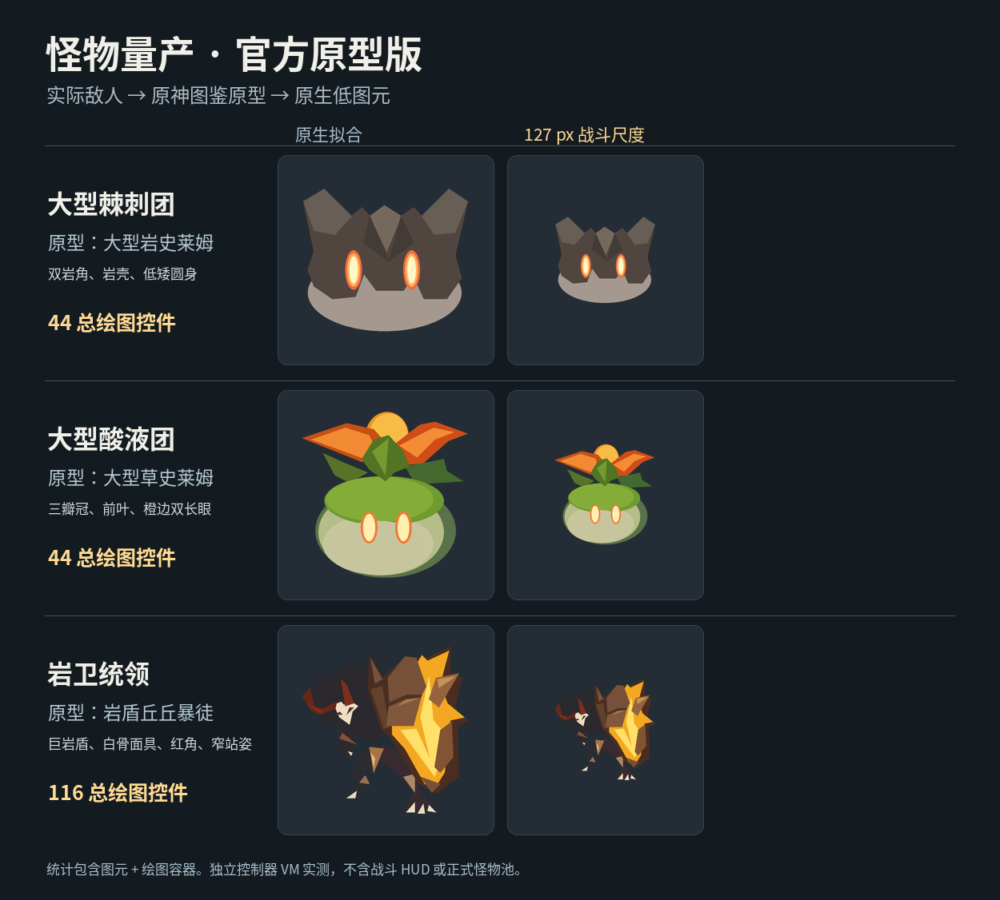

# 怪物量产试制：直接参考原神图鉴

以真实可出场敌人切入，结合战斗定位和外形找最接近的原神官方图鉴原型，不强求同名、不因无完全匹配停工。早期仓库衍生稿三只试稿（119／269／205 总控件）超出相应入口档，不是量产候选，不以其作为原型权威。

| 关卡敌人 | 直接参考 | 本稿保留 | 图元＋容器＝总 |
|---|---|---|---:|
| 大型棘刺团 `spike_slime_l` | [大型岩史莱姆](https://wiki.hoyolab.com/pc/genshin/entry/2127?lang=tr-tr) | 双岩角、中央岩脊、橙环长眼、石壳和低矮圆身 | 41＋3＝44 |
| 大型酸液团 `acid_slime_l` | [大型草史莱姆](https://wiki.hoyolab.com/pc/genshin/entry/2130?lang=ja-jp) | 三瓣大花、前叶、长眼及浅绿圆身。不同于小草史莱姆，保留大花冠，未简单放大 | 41＋3＝44 |
| 岩卫统领 `centurion` | [岩盾丘丘暴徒](https://wiki.hoyolab.com/pc/genshin/entry/2139?lang=ja-jp) | 巨盾、骨面、红角、窄站姿；按防护定位选原型，不要求同名 | 112＋4＝116 |

游戏名来自固定 Release 的 `data/enemies.json` 和第二幕 `src/lua/abyss_act2_enemies.lua`；后者的 `act2_centurion_mystic` 实际包含该单位。[42 个名录与覆盖状态](roster.md)。本批不改任何游戏绑定、规则、开关或 Release。

图鉴链接及源字节哈希在各目录 `report*.json`；直接看的是 HoYoWiki 条目实际展示图，不附原图、不将其当作贴图，不推定商用再分发许可。仓库仅存新拟合的原生图元及其重建图。

三个布局在仓库绘图控制器 Lua VM 下各测 120 个静态姿态，零图元重写、释放归零（见 `runtime*.json`）。这不是实际怪物 Host 的全池计数、设备帧率或发布通过。初始上限为 44/119 总绘图控件，包括容器分页，不包括战斗 HUD。图审未通过时在同档先把预算移向剪影/脸/关键辨识点，不加回碎纹。

## 复现

以固定 `1cc5479b713edab6fd26db4e20f8eb22b7401cb2` 的生产原生控制器和几何脚本为 REPO；从该库根运行 `node "$BATCH/standalone-probe.mjs" "$BATCH/geo-slime/native-layout.json"`。其他两份输入为 `official/dendro/native-layout.json`、`mitachurl/official119/native-layout-whole-116.json`。几何重建脚本依赖 NumPy 与 Pillow；公共三角剖分输入是 `../history/fit200/fit.py`。原作取材依每份报告的 `officialImage`／`referencePixelUrl` 和 SHA256 获取，不需另找一张相似图。
