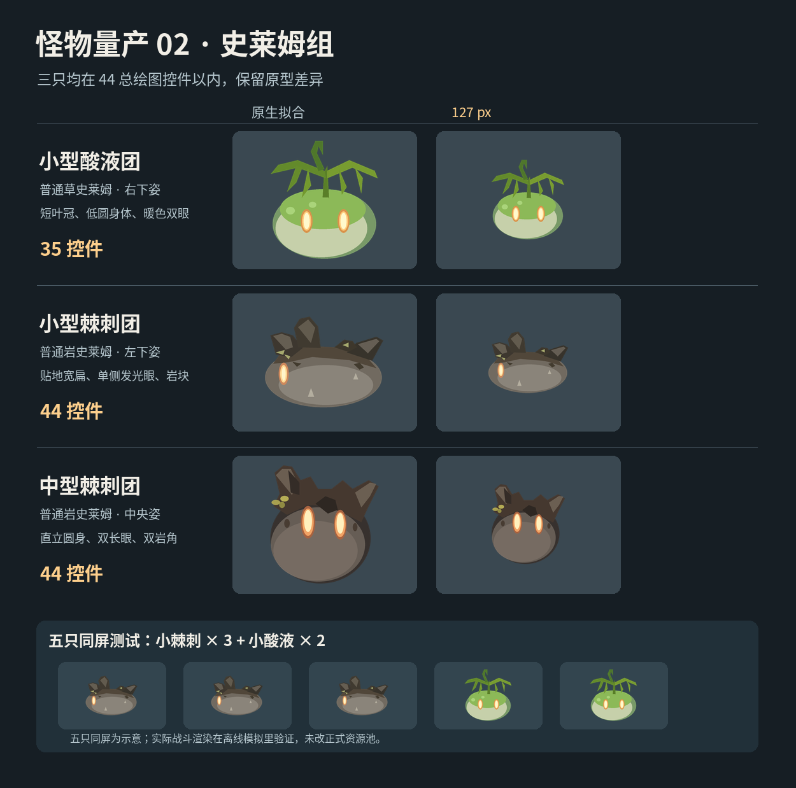

# 怪物量产 02：小型／中型史莱姆



沿用 [44／119 绘图入口](https://github.com/FurinyaWorks/Slay-the-Heavens/pull/705)，按 Release 实际遭遇补齐小型／中型缺口。原型图仅留来源链接与字节哈希，不把图鉴画面作为游戏贴图或仓库附图。

| 敌人 | 对照原型和姿态 | 图元＋容器 |
|---|---|---:|
| 小型酸液团 `acid_slime_s` | [草史莱姆 2214](https://wiki.hoyolab.com/pc/genshin/entry/2214?lang=en-us)，右下矮圆体、下垂叶冠、暖色长眼 | 32＋3＝35 |
| 小型棘刺团 `spike_slime_s` | [普通岩史莱姆 2137](https://wiki.hoyolab.com/pc/genshin/entry/2137?lang=en-us)，左下贴地宽扁姿、单侧发光眼、岩块 | 41＋3＝44 |
| 中型棘刺团 `spike_slime_m` | 同一官方普通岩史莱姆的中央直立姿，保留双眼、非对称双岩角。不是官方“中型”物种，也不是把小档或大型直接放大 | 41＋3＝44 |

各稿原生绘图均**没有半片遮罩**，保留大色面；在精确 Release `33d71575c5f186a1b54f7bf3e4f1826c145aa1d9` 实际原生绘图控制器 VM 下，各跑 120 静态 pose、暂停回访和完整释放，零图元写入/重建、释放归零。抠选的是 HoYoWiki 实际显示图中的各自姿态，不推断官方原画作者身份或再分发权。

## 第一组五实例 Host 已用这批新稿验证

以**临时输入**注入真实 Combat / GameUI / MonsterArt 生成路径，严格验证居中、比例 1、无掩码的行格式。真实遭遇 `Lots of Slimes` 生成小棘刺 3 只、小酸液 2 只，5 个独立外观及位置，原生控件用的是本批 41/32 行（187 个可见图元），不是旧贴图或别名。验了逐图元图像、位置、大小、XYZ 和应用既有姿态着色后的 RGBA，120 帧无重设初始旋转，退掉 1 只后其余 4 只未重绑/换位；中棘刺另跑单只 Host。

**不等于生产控件省到 187。** 离线生成仍按整库最大图稿分配每只 **600 图元槽**，本轮未修改该机制，没有游戏实机、官方导入、帧率或实际容量数据。不得从画稿图元数反推整套战斗 UI 已变轻，也未改游戏绑定、玩法、Release 或 Develop。

[Host 回执](formation-check/native-report.json) · [原始日志](formation-check/native-raw.log) · [下一组开局怪物的官方原型取材](next-roster/README.md)。

## 复现

在精确 Release checkout 下准备已有锁定依赖与人物预览 LFS（用于仓库自带的 VM 启动，不是怪物素材），设 `REPO` 为该目录；`BATCH` 为本目录，`HISTORY` 为本库 `../history/fit200/fit.py` 的绝对路径。取材时下载各报告中的图鉴链接并核对 SHA；保存在 `acid-small/official-reference.png`、`spike-small/source.png`、`spike-medium/official.png`，不上传原画。

```sh
cd "$BATCH"
python acid-small/build.py "$REPO" "$HISTORY"
python acid-small/encode.py
python spike-small/fit.py "$REPO" 25
python spike-small/finalize.py "$REPO"
python spike-medium/render.py "$REPO" "$HISTORY"
python review-board.py --archive
RELEASE_REPO="$REPO" node formation-check/run-native.mjs
cd "$REPO"
node "$BATCH/standalone-probe.mjs" "$BATCH/acid-small/native-layout.json"
node "$BATCH/standalone-probe.mjs" "$BATCH/spike-small/native44.json"
node "$BATCH/standalone-probe.mjs" "$BATCH/spike-medium/native-layout.json"
```
