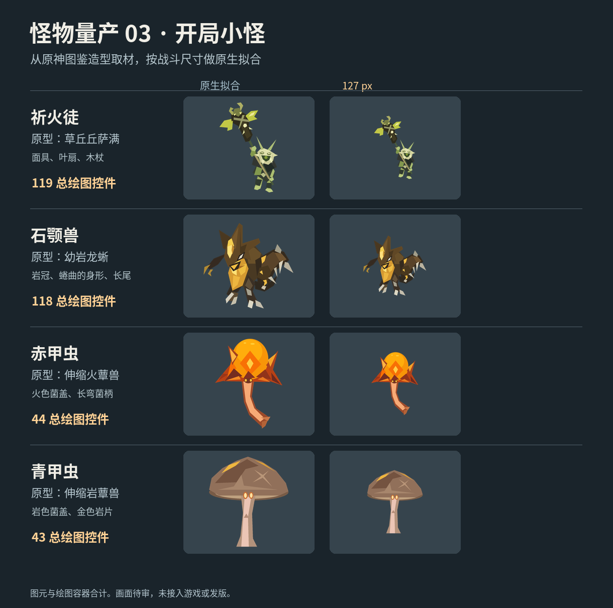

# 怪物量产 03：另四种开局敌人



以 Release 实际敌人和 [已核实原型表](../monster-pilot-02/next-roster/README.md) 为入口。四份是新原生拟合候选，不是沿用旧生成衍生图。项目名称不必与原型逐字相同；只借外观，不改技能、战斗逻辑或绑定。

| 敌人 | 原神图鉴原型 | 重点保留 | 图元＋容器 |
|---|---|---|---:|
| 祈火徒 `cultist` | [草丘丘萨满](https://wiki.hoyolab.com/pc/genshin/entry/2213?lang=en-us) | 面具、叶扇、仪式木杖和蹲伏姿态 | 115＋4＝119 |
| 石颚兽 `jaw_worm` | [幼岩龙蜥](https://wiki.hoyolab.com/pc/genshin/entry/2144?lang=en-us) | 少年岩冠、琥珀腹、蜷曲四肢与尾 | 114＋4＝118 |
| 赤甲虫 `red_louse` | [伸缩火蕈兽](https://wiki.hoyolab.com/pc/genshin/entry/2731?lang=en-us) | 火色伞帽、双眼和长弯菌柄 | 41＋3＝44 |
| 青甲虫 `green_louse` | [伸缩岩蕈兽](https://wiki.hoyolab.com/pc/genshin/entry/2732?lang=en-us) | 岩色伞帽、金色岩片、双眼和直菌柄 | 40＋3＝43 |

均以条目实际展示像素画大色面、无半片蒙版；未接入任何游戏绑定、资源池、开发或发版分支。四只用精确 Release `33d71575c5f186a1b54f7bf3e4f1826c145aa1d9` 的 standalone VM 分别测了 120 个静态姿态，零图元写入，释放归零。**这是画稿和单独控制器证据，非整场战斗、引擎或设备验收。** 新图待视觉确认。

HoYoWiki 条目、直接图 URL、绘图和图鉴哈希见 [sources.json](sources.json)。本目录不分发第三方图鉴原图，不推断原画创作者身份或许可。原生图仅由项目使用的椭圆、三角等原生控件重建。

## 复现

在本目录将来源图按 `sources.json` 所列 SHA/名称准备（上一版本的原图不能替代）；`REPO` 指向上述精确 Release，`HISTORY` 指向本归档 `../history/fit200/fit.py`：

```sh
for d in cultist jaw-worm red-louse; do python "$d/render.py" "$REPO" "$HISTORY"; done
python green-louse/build.py "$REPO" "$HISTORY"
python review-board.py --archive native-board.png
```

在 Release 根逐个执行 `node "$BATCH/../monster-pilot-02/standalone-probe.mjs" "$BATCH/$kind/native-layout.json"`。
