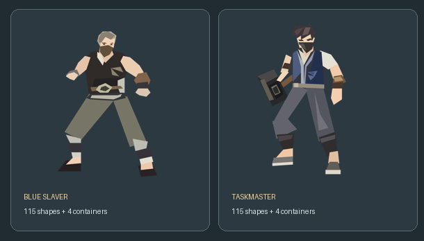

# 第五批 · 两种束缚系敌人

| 实际敌人 | 参照 | 图元＋容器 |
|---|---|---:|
| 蓝衣束缚者 `blue_slaver` | [盗宝团·拳术家](https://wiki.hoyolab.com/pc/genshin/entry/2200?lang=en-us)，双眼蒙面、短灰发、裸臂护具、宽腰带 | 115＋4＝119 |
| 缚役监军 `taskmaster` | [盗宝团·粉碎者](https://wiki.hoyolab.com/pc/genshin/entry/2208?lang=en-us)，宽锤、深 V 背心与裹腿 | 115＋4＝119 |

两份均用有实际像素依据的大色块原生三角；图鉴原图不随仓库分发。仅审阅候选，不替换正式资产。蓝衣束缚者的官方参照并非蓝衣，本稿原色不用于宣称已满足正式版身份辨识；正式修复中的既有青蓝简图不变。

