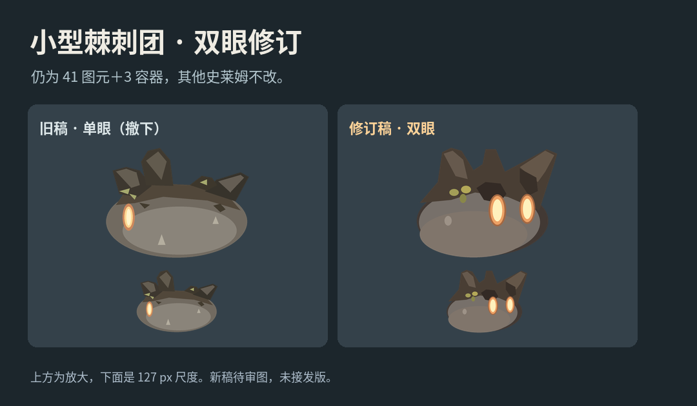

# 小型棘刺团双眼修订（仅此一只）



Owner 指定只改 [第二批的小型棘刺团](../monster-pilot-02/README.md) 单眼旧稿，另外两只保留。此前误将侧视遮挡当作一只眼的造型；现改用 [HoYoWiki 普通岩史莱姆 2137](https://wiki.hoyolab.com/pc/genshin/entry/2137?lang=en-us) 右下双眼矮身姿态，不沿用左下单眼侧视。保留矮身、岩角、暖灰褐体和橙环双眼，仍 **41 图元＋3 容器＝44**、零半片蒙版。旧稿仅历史对照，禁止作为新视觉候选；双眼新稿待图审。

- 其他史莱姆布局和图稿不变；无产品绑定、开关、Release/Develop 修改。
- 精确 Release `33d71575c5f186a1b54f7bf3e4f1826c145aa1d9` 的 standalone 控件试验通过，120 帧不写图元、释放归零；严格 row-to-slot 适配通过。
- 用新布局替换原低槽位试点的小棘刺激活输入重新验证：两种双怪编组、五只同屏和非激活图库回退通过。五怪可见 **187**（由断言通过的实际布局推导），隔离 opt-in 仍 **41 槽/只**。不是现有生产池、官方设备或发版验收。见 [Host 日志](stock-pilot-raw.log)。

## 复现

设 `REPO` 为上述精确 Release，准备已有锁定依赖和 LFS；将图鉴页 API header 图按 [旧稿来源回执](../monster-pilot-02/spike-small/report.json) 的 URL/SHA 下载至 `spike-small/official.png`。仓库仅保存新拟合绘图，不保存第三方图鉴原图。

```sh
python spike-small/render.py "$REPO" ../history/fit200/fit.py
python spike-small/board.py spike-small/comparison-native.png ../monster-pilot-02/spike-small/preview.png --archive
ACID_MEDIUM_LAYOUT="$(realpath ../monster-pool-qualification/acid-medium/native-layout.json)" RELEASE_REPO="$REPO" node run-revised-pilot.mjs
```
