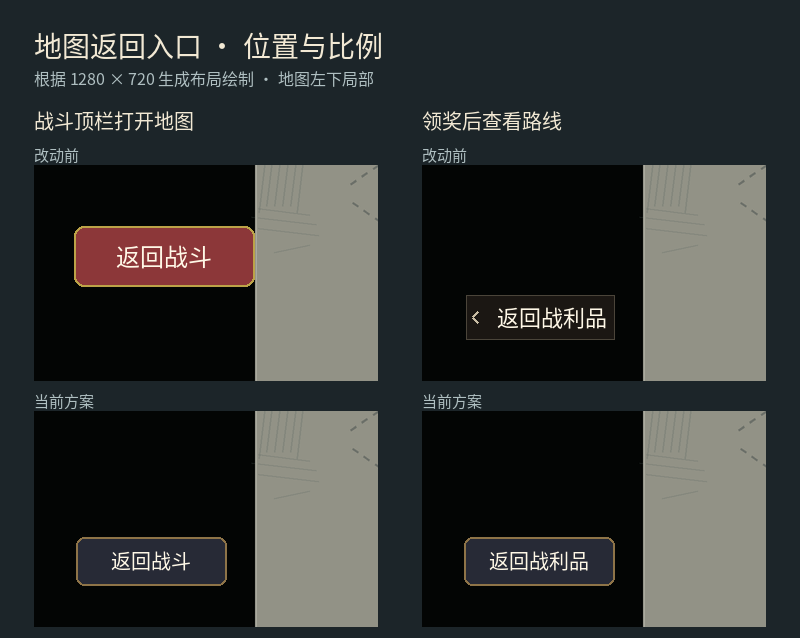

# 局内按钮产品评审

图以本作地图画面为底，按正式生成布局绘制按钮。两列展示地图左下的同一画布区域。字体和图元属于离线近似。

| 场景 | 布局和操作层级 |
| --- | --- |
| 地图 | 「返回战斗」和「返回战利品」共用左下锚点。1280×720 画布上距左、下各 42，按钮 150×48。对照用户截图里的《杀戮尖塔》式留白和返回战利品的体量。地图入口保留各自文案，鼠标悬停、按下、取消和禁用使用同一组状态。 |
| 战斗 | 「结束回合」保留参考布局中的右下位置和 143×56 尺寸，以蓝灰圆角显示，与上方地图快捷入口和下方弃牌堆区分。 |
| 奖励与选牌 | 金币、遗物、药水和卡牌沿用居中 296×56 奖励行，统一圆角比例和按下缩放。领奖后的「继续」在右下，使用主操作色。进入选牌后，下方「跳过」使用次操作色。「确认」在需要确认的其他选牌页面使用主操作色。 |
| 房间 | 商店、营地和事件沿用页脚返回、确认的布局。事件选项共用圆角和按下反馈。感官石的奖励组选项、跳过本组、宝箱与首领遗物奖励行、配对事件重试同样使用圆角。卡牌、商品和营地插画本身是可以点击的内容，保留各自的形状。 |
| 菜单和弹窗 | 保留首页已经批准的文字菜单构图，统一选角、暂停、退出确认、牌组、遗物及药水弹窗操作的材质。结算页的「重新启程」与「结束并结算」使用共享四态。青色用于确认，低对比深底用于次要操作，红色沿用已有退出和取消材质。顶栏图标和地图滚动箭头使用紧凑的图标交互。 |

按钮的圆角比例、描边、按下缩放和状态色集中在 `ui_theme.json` 的 `officialAssets.actionButton`。原生预设按钮、房间动态绘制和地图光标区共用同一材质入口，各自继续由对应页面处理点击和焦点。奖励列表保留左侧图标、布局 token 和领取状态。

评审重点是两个返回入口的位置能否形成肌肉记忆，以及领奖、继续和跳过能否一眼区分。合并目标为 `develop`，本次发版独立推进。
